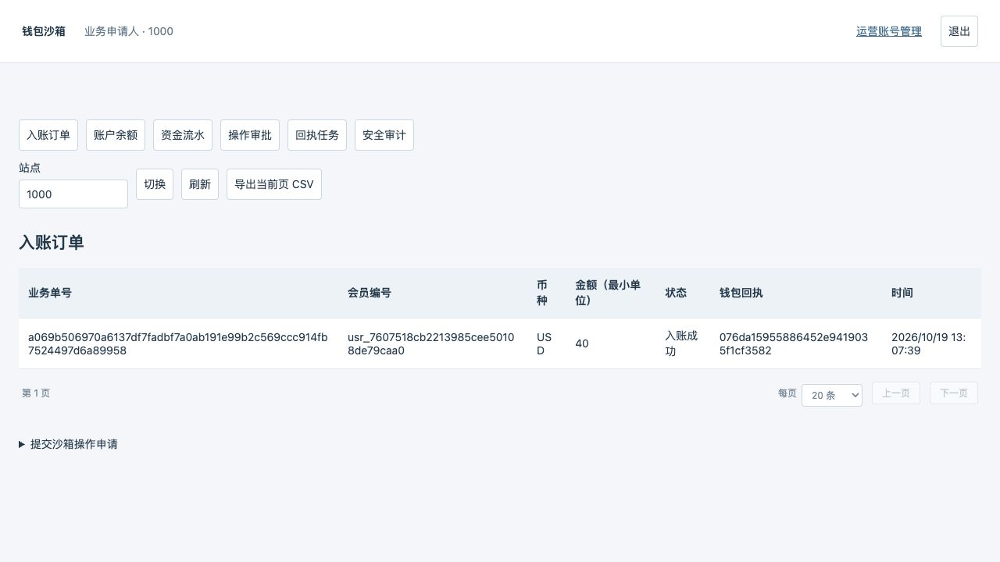
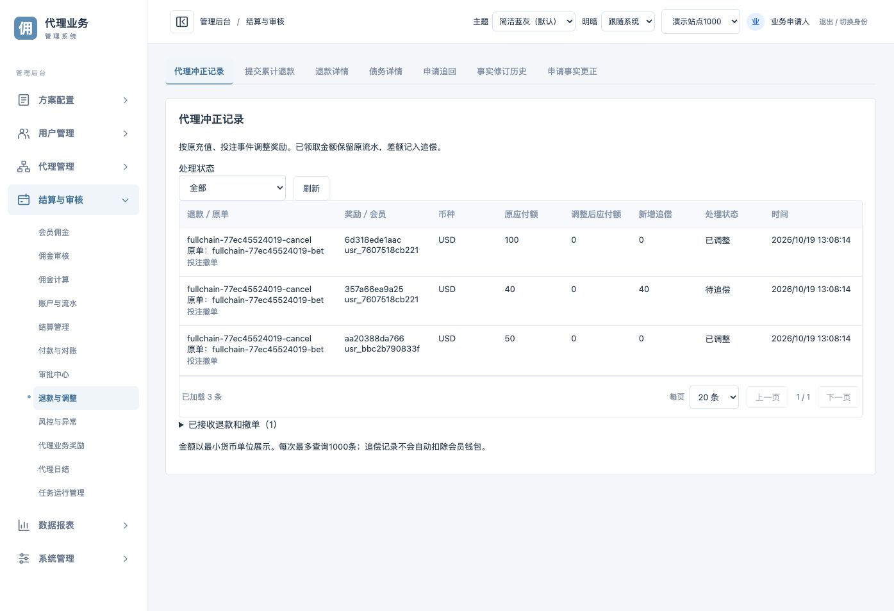
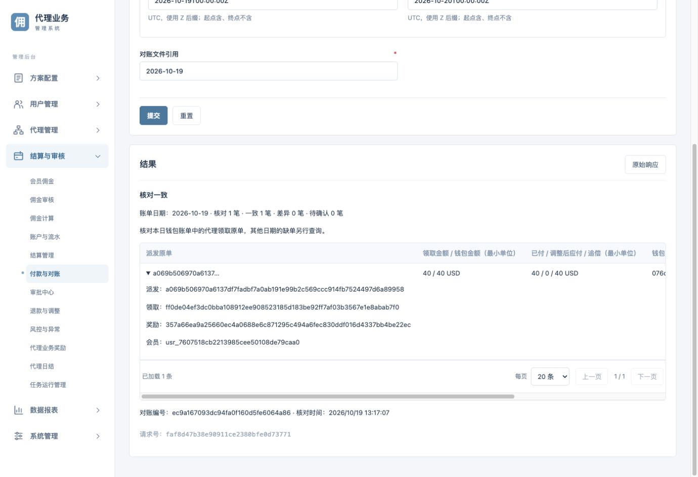

# 浏览器代理佣金全链路验收

日期：2026-10-19。独立测试租户 `fullchain-77ec45524019`，浏览器连接真实页面和真实服务，没有拦截或伪造接口响应。使用现有运营用户系统、模拟会员与独立模拟钱包；测试租户和钱包数据库隔离于共享演示站点。

## 业务结果

| 环节 | 浏览器验证 |
| --- | --- |
| 邀请注册 | 新推荐人注册并生成邀请链接；新受邀会员通过该链接注册，直属上级正确 |
| 达标 | 受邀会员在来源模拟页面保存充值10.00 USD和有效投注100.00 USD，自动投递成功；推荐人页面显示1名有效直属及逐项达标 |
| 计佣与日结 | 自动worker按0.4000%计得0.40 USD，产生待审核佣金 |
| 独立审核 | ops.applicant仅查看，未提供审核按钮；切换ops.approver核对贡献明细后审核通过 |
| 领取 | 推荐人浏览器领取每日佣金，先显示受理，确认后已领取收益0.40 USD |
| 钱包到账 | 独立钱包入账成功、仅1条资金流水，金额40分；同笔回执已送达 |
| 冲正追偿 | 受邀会员浏览器提交原投注撤单，后台显示原应付40分变0、新增追偿40分；未领推荐/受邀奖励取消 |
| 原单追踪 | 后台派发页可查领取、奖励、派发、会员、钱包回执、回调编号和请求编号 |
| 对账 | 浏览器发起wallet-sandbox本日账单核对：核对1笔、一致1笔、差异0笔、待确认0笔；已付40、应付0、追偿40分 |
| 只读复核 | 独立钱包余额40分、流水1条；佣金内部钱包无重复入账。MySQL已付/目标/追偿及持久化对账结果一致 |

## 同笔编号

- 奖励：`357a66ea9a25660ec4a0688e6c871295c494a6fec830ddf016d4337bb4be22ec`
- 领取：`ff0de04ef3dc0bba108912ee908523185d183be92ff7af03b3567e1e8abab7f0`
- 派发/钱包商户原单：`a069b506970a6137df7fadbf7a0ab191e99b2c569ccc914fb7524497d6a89958`
- 钱包回执：`076da15955886452e9419035f1cf3582`
- 回调：`384c413a017bbfe8c327044cc5db744e`
- 对账：`ec9a167093dc94fa0f160d5fe6064a86`

## 页面证据

独立钱包到账：

原单撤销后的追偿：

浏览器对账结果：

## 本次发现并修复

1. “代理领取派发记录”被通用奖励页覆盖，点击不能切换。新增独立只读模块，默认20条，支持20/50/100及服务端游标翻页。
2. 原结算对账将代理领取原单送入旧付款仓储，返回NOT_FOUND。按用户具体确认增加分流：代理原单只核对，不派发、不确认或改动资金；非代理原单继续原对账，未知原单继续拒绝。结果在原幂等命令结果中保存。
3. 对账结果明确展示历史已付、调整后应付和追偿；目标归零不等于钱包已退款。

【涉及其他业务】原结算付款共用钱包账单分流。原会员领取、后台派发及共用回执/对账三项真实钱包回归通过；错金额、错回执、错终态、跨站、未知原单、未确认资金不被对账修改均已测试。原权限、签名、站点绑定及审批未放宽。

## 验证和边界

- 七项affiliatewallet真实MySQL测试及race检查通过，包含两项对账测试及四项差异子场景；18项契约、后端全量编译测试、前端构建和32项测试通过。
- `TestAffiliateBrowserEvidence`在同一只读MySQL快照中核对领取、账本和持久化对账结果；独立SQLite只读核对钱包及来源投递。
- 方案作为测试前置配置预置。日结跨日使用已有测试二进制的独立时钟；水位由工具只读原始已投递事实生成并签名提交，不是浏览器代签，也未改电脑或共享演示服务时间。
- 对账只覆盖钱包指定日账单返回的原单；不声称完成跨日期缺单扫描或真实外部钱包生产验收。
- 私有证据和测试运行配置保存在 `.local/fullchain/browser1/`，不加入Git；测试入口为会员60504、佣金Web60506、钱包60507（均127.0.0.1）。现有19486/19986入口继续保留。
- 部署时应同步更新后端、前端及钱包，并核对实际提交版本与运行二进制；本报告记录的是本机模拟验收结果。
