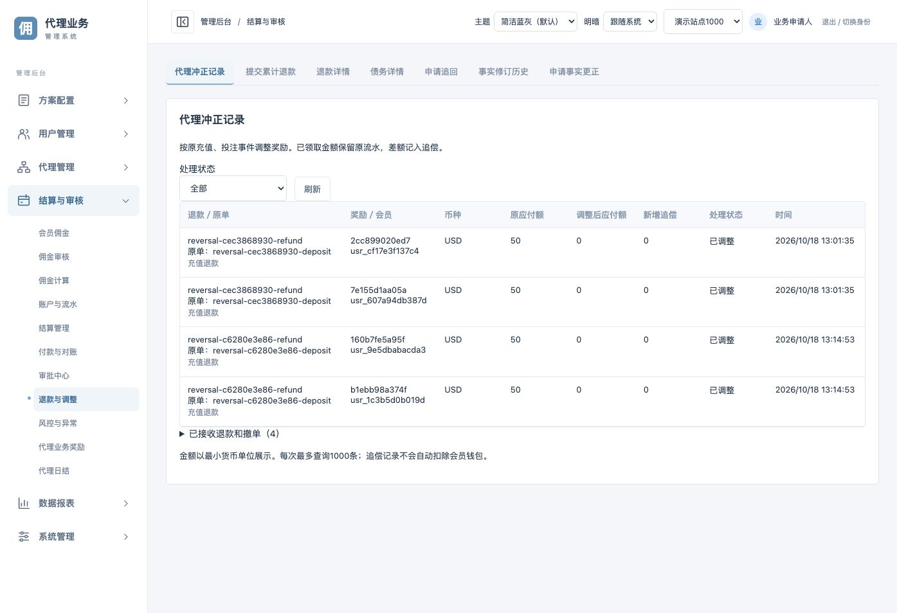

# 代理撤销与冲正

- [职责](#scope)
- [来源接口](#source)
- [资金规则](#money)
- [后台查询](#view)
- [验证与边界](#tests)

<a id="scope"></a>
## 职责

会员业务系统发出充值退款、投注撤单事实；`ex-member-sandbox` 提供模拟入口。ExCommission关联原事实、重算代理奖励和佣金并登记追偿。钱包保留原入账流水，本功能不会直接扣款。

```text
会员退款/撤单 --> 来源事件箱 --> 验签/原单关联/累计上限
                                     |
                +--------------------+
                v
        事实净额 --> 资格与原方案重算 --> 佣金差额
                                           |
                     +---------------------+------------------+
                     v                     v                  v
                  未领取                 已领取             在途未知
                调减/取消             保留领取+追偿        整笔回滚重试
```

原始成功事件、冻结日结结果、领取记录、钱包交易不删除。冲正净额与资金差额分别存表，奖励变更沿用原历史版本表。

<a id="source"></a>
## 来源接口

`POST /v1/affiliate/reversals`，要求来源身份 `affiliate:ingest`、`Idempotency-Key` 和 `X-Affiliate-Signature`。当前沙箱来源支持独立HMAC协议，其他自定义来源须实现ReversalSource验签端口，不能直接复用未经定义的映射。

```json
{
  "source_id":"sandbox",
  "event_id":"refund-delivery-001",
  "business_id":"refund-order-001",
  "original_event_id":"original-delivery-001",
  "original_business_id":"deposit-order-001",
  "external_user_id":"member-001",
  "kind":"DEPOSIT_REFUNDED",
  "currency":"USD",
  "amount_minor":"100",
  "valid_bet_minor":"0",
  "business_time":"2026-10-18T09:00:00Z",
  "reason":"充值退款"
}
```

| 字段 | 规则与作用 |
| --- | --- |
| event_id | 投递事件唯一编号，重试保持原值 |
| business_id | 独立退款/撤单业务单号，同站点来源内唯一；不能用新单号绕过退款上限 |
| original_event_id / original_business_id | 必须同时匹配原成功事件、来源及类型；原事件不是客户端可任意指定的收款目标 |
| external_user_id / currency | 必须与原事实一致，不能跨会员或跨币种冲正 |
| kind | DEPOSIT_REFUNDED对应DEPOSIT_SUCCEEDED；BET_CANCELLED对应BET_SETTLED |
| amount_minor / valid_bet_minor | 本次冲正增量，整数最小单位；充值退款有效投注必须0；累计及剩余有效投注不得超过相应原单金额 |
| business_time | 包含时区，最多微秒；不能早于原事件或晚于当前业务时间 |
| reason | 保留来源冲正原因，不作为权限依据 |

HMAC-SHA256十六进制签名使用与当前来源一致的私有密钥，内容为下列前缀后紧接原始正文：

```text
affiliate-reversal-v1\n{tenant_id}\n{app_id}\n{source_id}\n{raw_body}
```

成功响应包含 `event_id/business_id/accepted/status=APPLIED`；重复成功返回原结果或accepted=false，不重复调整。原事件尚未到达返回503 ORIGINAL_EVENT_PENDING；原付款有reserved金额返回503 PAYMENT_RESULT_UNKNOWN。两者均不缓存为确定失败，原幂等键可继续重试。来源自动队列保留原始正文、签名规则和幂等键。

超过原单累计金额返回422；错会员、同单改参数等冲突返回409；缺少权限或错误签名拒绝。需要修复业务拒绝原因后按原事实补发，不覆盖原事件。

<a id="money"></a>
## 资金规则

- 尚未关账：资格与以后计佣使用净充值/净投注；原成功事实仍参与原始来源清单核对，冲正不混入成功事实的水位摘要。
- 已冻结未结算：保留Results，将净额重算保存至RestatedResults；后续日结使用冲正后结果。
- 已结算：使用原日结配置、原业务时间的关系和冻结起点重算，不使用当前方案代替历史方案。人工审核金额按首次冲正前的审核金额与原计算额比例调整，整数向下取整。
- 未领取奖励：减少对应账本目标和待领取金额；全额失效标记CANCELLED，保留原金额及变更历史，不再可领。
- 已领取奖励：CLAIMED状态、原金额和钱包交易保留；减少账本target，差额进入debt，并保存RECOVERY_OPEN记录。
- 付款结果未知：整笔冲正回滚，不先冲一部分奖励；等待原付款查明后用原事件重试。
- 推荐/受邀终身奖励：按原方案、原解锁时点和原占用会员复核资格。失效后不释放历史占用来重新领一遍。
- 极端风险去重重分配导致的正向差额标记REVIEW_REQUIRED，不自动增加已批准金额或扣减钱包；需业务复核处理。

当前默认仅登记追偿，不自动抵扣未来佣金、不从钱包撤回入账。本批不新增自动扣款或追偿结案策略。原业务总表中的原始充值/投注财务口径保持，计奖资格与有效量读取净额；应结合冲正明细核对。

<a id="view"></a>
## 后台查询

`GET /v1/affiliate/reversals`，沿用affiliate:read。响应 `items` 是奖励差额及新增追偿，`events` 是已接收的退款撤单，包括未产生新差额的事件；均最多1000条。

代理后台“结算与审核 → 退款与调整 → 代理冲正记录”只读展示，接入公共运营账号和站点授权。后台浏览器提交来源POST被BFF明确拒绝。原通用退款、债务详情及追回申请入口保留。



<a id="tests"></a>
## 验证与边界

本地独立API19890、管理后台19792、会员沙箱19790；与现有19486后台和之前钱包演示独立。使用随机隔离tenant、独立会员与来源数据库，未操作真实资金。

已验证：原领取回归；未领取消；已领推荐/受邀追偿；已领日结243→2、追偿241（均最小单位）；未知付款原子回滚后同键重试；原事件乱序后同键恢复；超额、篡改会员、跨站、错签、角色隔离拒绝；关账前后使用原冻结方案；真实进程邀请注册到退款撤单自动投递。前端构建、BFF来源入口保护和旧会员/管理员转发回归通过。

大批历史日期重算目前在站点事务锁内串行完成，正式大规模接入前需要分批任务与分页。新路由契约已同步，本地功能分支尚未提交、合并或推送。

【涉及其他业务】影响代理事实净额读取、资格投影、推荐/受邀奖励、日结及领取账簿；原始财务事实、通用计佣退款和钱包实现没有改写。上述代理回归已验证；真实外部来源、外部钱包与生产环境未联调。

来源当天已有未确认冲正时会等待投递后再关账；已确认冲正仍不计入成功事实的水位摘要。

契约检查18项通过；同期补齐原数据接入契约缺少的409响应及空参数声明，并纠正只读方案预检不需要幂等命令的旧测试假设，未改原接入或预检实现。
