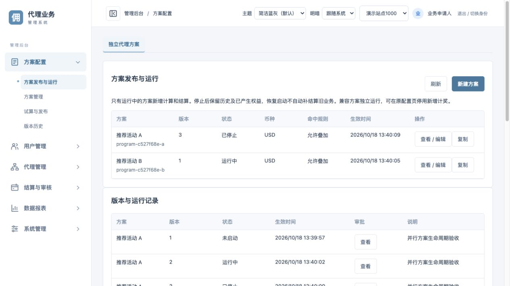
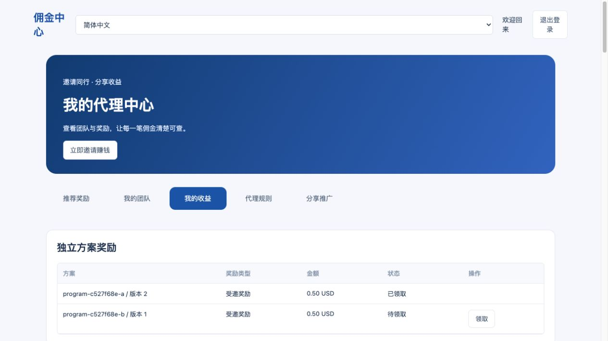

# 代理方案发布与运行

- [运行规则](#rules)
- [使用方法](#usage)
- [接口与审批](#api)
- [计算和权益](#money)
- [验收与边界](#verification)

<a id="rules"></a>
## 运行规则

方案在 ExCommission 管理，入口为代理后台“方案配置 > 方案发布与运行”。多个独立方案可以同时启动。

| 发布状态 | 生效后新增计算 | 生效后新增结算 | 历史记录 | 已产生权益 |
| --- | --- | --- | --- | --- |
| READY 未启动 | 否 | 否 | 可以查看 | 保留 |
| RUNNING 运行中 | 是 | 是，等待来源关账且到达日结时间 | 可以查看 | 按原规则处理 |
| STOPPED 已停止 | 否 | 否 | 可以查看 | 继续审核、领取、对账和必要冲正 |

发布不等于一定启动：发布时明确选择状态和生效时间。未来发布版本在指定时间生效，审批时已经过期的生效时间会被拒绝，需要重新申请。

停止前尚未生成结算单的业务保留原始事实和命中记录；停止后不生成新结算，恢复后不自动补结算旧运行区间。运行中连续修订配置时，同一连续运行区间的旧版本仍按原配置结清；中间出现停止或未启动状态，就不属于连续运行。

同一方案的币种、币种精度、时区和人数累计周期固定。改变这些口径要创建独立方案，不兑换、迁移或重算旧资金。

原有代理配置保留为兼容方案，继续在原配置页审批管理。它与新方案独立叠加，不参与新方案的互斥组或优先级组；如果业务不希望并行计奖，应先通过原审批流程停用兼容方案的新增计奖，再启动新方案。旧配置及历史权益不会被删除。

<a id="usage"></a>
## 使用方法

1. 新建方案，或复制已有方案。设置名称、币种、时区、业务来源、会员范围、充值/投注类型。
2. 设置达标条件、受邀奖励、推荐阶梯、等级比例、扩展算法及去重规则。
3. 选择命中规则和运行状态，填写未来生效时间及变更说明。
4. 试算验证金额，执行发布预检，再提交独立审批。
5. 审批人使用自己的运营账号审批，申请人不能批准自己的申请。
6. 生效后在当前方案、版本与运行记录、事件命中记录、奖励与佣金记录、日结记录中检查结果。

| 命中规则 | 行为 |
| --- | --- |
| STACK 允许叠加 | 每个命中方案独立计算，权益编号包含方案 |
| PRIORITY 按优先级 | 同组只选择数值最高的方案，低优先级保留未入选原因 |
| EXCLUSIVE 互斥 | 同组适用范围必须不重叠；发布预检发现重叠就拒绝 |

优先级并列、同组混用优先级和互斥、互斥适用人群重叠均拒绝发布。预检和审批执行都会检查未来生效时间边界，防止计划发布的配置在稍后发生冲突。最终收单仍做歧义校验。

来源和会员编号留空表示全部；多值以逗号分隔。范围按充值/投注事实所属会员匹配，资金仍发给原规则确定的受益会员，不改变邀请关系。业务类型选择仅充值或仅投注时，另一类事实不参与本方案；同时要求充值和投注的资格可能因此无法达标，需按业务目的配置。

<a id="api"></a>
## 接口与审批

| 方法和接口 | 权限 | 用途 |
| --- | --- | --- |
| GET /v1/affiliate/programs | affiliate:read | 查看本站版本、当前状态、命中、权益及日结历史 |
| POST /v1/affiliate/programs/preview | affiliate:configure | 预检，不写权益、不发布 |
| POST /v1/affiliate/programs/requests | affiliate:configure | 创建发布、启动、停止或修订审批；必传 Idempotency-Key |
| POST /v1/affiliate/programs/simulate | affiliate:read | 各层业务量试算，仅预览 |
| GET /v1/me/affiliate/program-rewards | member:read | 只能查看当前登录会员的独立方案奖励 |

`AFFILIATE_PROGRAM` 使用既有 `affiliate:approve` 和公共审批流程，保留本人不能审批、站点授权和版本冲突检查。浏览器不能指定权限范围或会员身份。

发布请求包含 `program_id`、`name`、`expected_revision`、`state`、`effective_from`、`reason`、`match`、`config`。`expected_revision` 是方案自身的最新版本号；新方案为 0。每次发布都保留完整版本和审批编号，不能原地覆盖历史。

会员继续通过原签名领取接口提交 `kind`，独立方案额外传 `program_id`；不传只领取兼容方案。原请求正文和幂等行为保持兼容。跨方案不会混领，不同币种不会混加。

<a id="money"></a>
## 计算和权益

```text
Source fact -> Signature + original-order deduplication
            -> Effective version at business_time
            -> Scope matching + group selection
            -> Immutable receipt + program facts
            -> Qualification rewards / closed-day commission
            -> Existing review -> Member claim -> Wallet ledger

STOPPED -> Historical reads + existing rights + reversals
        -> No new calculation or settlement
```

原业务单、命中方案版本和资金写入在同一站点事务内完成。重试不重新选择方案，也不重复发奖。并行方案使用真实站点和真实会员身份，方案编号只用于业务隔离，不作为权限或伪造站点。

推荐奖励按同一方案的终身阶梯保留既有会员占用；修订版本不重新领取已完成阶梯。日结佣金按方案、版本、会员和业务日唯一，生成待审核单；审核通过后进入原领取和钱包账本。

日结必须等待来源水位。方案与来源时区不同，需覆盖本方案整日涉及的全部来源自然日，不能仅凭相同日期文字提前关账。没有完整水位继续等待。

退款撤单按原权益配置快照及原命中事实净额重算。未领取部分调减；已领取部分保留钱包流水并登记追偿；付款结果未知则整体回滚，来源用原单重试。不自动扣钱包，正向差额仅记复核依据。

<a id="verification"></a>
## 验收与边界

已验证本地 MySQL 事务链路：未启动、并行叠加、发布权限、自审拒绝、优先级和冲突预检、停止后禁止新结算、恢复不补旧账、停止后旧权益审核领取入账、原方案退款追偿及重复原单防重。原代理日结、领取与冲正回归通过。

独立进程验收工具：`tools/affiliate_programs_acceptance.py --dir <隔离预览配置目录>`。只允许 `program-preview-*` 的本机环境，用真实模拟会员注册和自动投递，不直接改业务表。

页面当前显示最近 1000 条事件命中、最近 1000 条独立方案权益；完整权益可通过已有奖励记录查询接口分页查询。版本和日结记录保留，不删除。

当前实现复用站点串行锁，按方案读取事实、会员和历史。已做事务和竞态回归，尚未进行大站容量压测。独立外部钱包适配在另一功能分支，本次到账验收使用现有内部钱包；不代表外部真实钱包已联调。

【涉及其他业务】新增事实接入编排、代理资格、推荐奖励、日结、审核、领取、冲正与财务展示的方案隔离；审批增加专用类型权限映射。原登录、站点识别和 BFF 鉴权实现没有修改。旧权益继续使用原权限、风控、幂等和钱包账本，兼容面板按原币种与兼容方案权益展示，独立方案在新页面查看。

### 本地页面验收



已在浏览器用公共运营账号查看 A 方案已停止、B 方案运行中，以及 A 的历史奖励仍可查询。会员浏览器领取 A 的旧奖励后显示已领取，钱包接口确认余额 50 最小单位，即 0.50 USD；B 的奖励保持待领。已有版本编辑的发布预检和多层试算也已在页面验证。



本地隔离演示进程：API 19891、worker 19892、Web 19793、模拟会员 19794、会员身份 19796。worker 已启动，业务日需等完整来源水位与日结时间；日结边界在集成测试中推进时钟验证，不伪造当天已关账。
