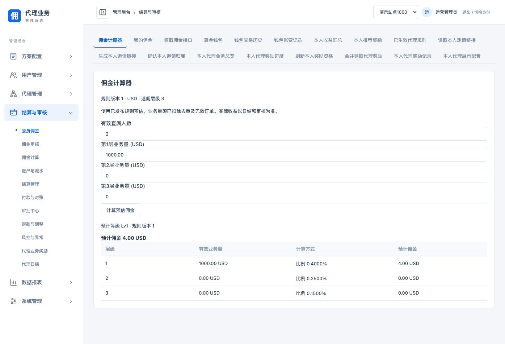

# 代理方案扩展

- [操作入口](#entry)
- [规则含义](#rules)
- [版本与独立方案](#versions)
- [接口与兼容](#api)
- [验收与接入边界](#acceptance)

## 操作入口

19486后台：“系统管理 → 推荐返佣 → 推荐返佣配置”。读取原配置后，选择“启用扩展返佣规则”，设置1至64个物理返佣层级，展开每个代理等级，逐层选择计算方式。未启用时继续使用原三层比例。旧等级门槛、三套有效条件、推荐阶梯、受邀奖励及风险策略继续保留。

“结算与审核 → 会员佣金 → 佣金计算器”使用本站已生效方案；后台运营账号调用独立管理试算接口，不再冒用会员身份。输入有效直属人数与各层正常货币金额，例如1000.00 USD；转换为最小单位由页面完成。结果展示规则版本、等级、每层有效业务量、计算方式、佣金及距离下一级的差额。输入或配置版本变化后旧结果作废。

## 规则含义

| 方式 | 业务含义 |
| --- | --- |
| 比例 PROPORTIONAL | 本层有效业务量乘比例，向下取整到最小货币单位 |
| 固定金额 FIXED | 本层存在有效业务量时发放一次固定金额，不按每个会员重复发放 |
| 阶梯累进 TIERED | 从0开始连续区间，左含右不含；各区间分别乘比例，汇总后取整；最后一档无上限 |
| 受限公式 FORMULA | 白名单算术树，支持常量、有效业务量、有效直属人数、当前层级，以及加减乘除、最小值和最大值 |
| 本层佣金上限 | 在上述计算后封顶；勾选后填0表示本层最多发0，不代表不限 |

没有有效业务量的层级均返回0，不执行固定或公式奖励。公式常量、金额变量和输出使用最小货币单位，人数及层级为整数；新选公式默认0，必须明确配置业务规则。前端是结构化公式编辑器，不运行JavaScript或用户脚本。

公式最多64个节点、嵌套深度受限，中间整数/分母限制1024位二进制。发布前做区间证明：对合法业务量、人数和层级，拒绝可能除零、负佣金或未封顶越界的公式。允许通过MAX(0,差值)明确封底，通过MAX(1,人数)保护除数；保守证明不能通过的表达式需要改写。金额全程整数或有理数计算，不经过浮点。

日结按当日最终代理等级选择规则。先算每层总佣金，再将非线性规则按本层会员有效业务量分摊，最大余数补齐，余数相同时按会员ID稳定排序。贡献明细合计与佣金严格一致。物理层级不压缩；扩展方案按所配深度读取历史关系，旧方案仍只查询三层。

## 版本与独立方案

普通规则更新走原独立审批，首次批准立即生效，后续按原站点次日零点生效。已冻结结果、已解锁或已领取权益保持原版本。该扩展不自动发布新规则。

用户已选择：币种、精度、时区或人数统计周期变化时，新方案独立启用，旧方案保留结清。页面“方案变更预检”会返回NEW_INDEPENDENT_PLAN，并提供“去创建独立方案”入口。

此入口进入已有“方案配置 → 创建方案”，只预填所选币种与新方案名称。运营人员需配置新编号、路由、日历、条件、规则和参与范围，再完成试算、独立审批及生效安排。**它不是当前推荐返佣配置的自动克隆或一键替换；不会自动把扩展公式、资格或旧权益迁移到通用方案引擎。**两种规则格式和事件链路应按接入方案明确选择，不能让同一业务同时走两条计奖路径。

旧方案的历史版本、待审核/待领权益、钱包流水按原币种保留；不自动汇兑、追补、重算或把新旧统计周期金额相加。现有通用方案发布继续检查同路由方案冲突。完整切流需要明确来源发送边界和旧方案关账安排；本次不自动执行真实业务切流。

## 接口与兼容

- 配置新增可选commission_policy：depth和grades；每个grade指定level及完整layers数组，等级集合必须与levels一致。省略保持旧行为。
- 每层rule指定algorithm，并仅提供对应参数：rate_ppm、fixed_minor、tiers、formula；cap_minor可选。
- GET `/v1/affiliate/calculator`：后台affiliate:read，只读已发布本站方案。
- GET `/v1/me/affiliate/calculator`：保持member:read及本人绑定，只读本人站点方案。
- 两个计算器用qualified_members和重复layer_minor参数传入完整层数组。旧level1_minor/level2_minor/level3_minor保持兼容三层方案；非三层方案缺层直接400。
- 计算器返回estimate.layers全量结果及next_level差额，旧三项数组字段保留作兼容。不能用旧数组解读第4层以后的佣金，完整总额读取commission_minor。
- POST `/v1/affiliate/config-preview`：affiliate:configure；请求为config、expected_revision、reason。返回当前修订、最早生效时点、层数及切换策略。通过Web调用仍需CSRF和幂等请求头。预检不写事实、审批、奖励或资金；最终申请及审批仍重新校验。

## 验收与接入边界

- 领域：四层混合算法试算与实际日结一致；64层计入、第65层排除；65层配置拒绝；同层多会员的固定/阶梯/公式/cap分摊守恒且稳定；大于2^53金额精度、除零、负数、越界与安全区间校验。
- 真实MySQL：扩展规则配置申请与独立审批、后台完整四层试算、运营访问会员接口拒绝、缺层拒绝、改周期预检要求独立方案、原方案覆盖请求409。
- 浏览器：中文货币输入1000.00 USD得到Lv1佣金4.00 USD及分层明细；四层混合算法草稿预检200；改MONTH返回独立方案策略并进入新方案草稿。未提交或发布演示站点扩展规则。
- 旧链路：重复领取409且钱包余额和revision保持，原报表与奖励CSV通过；后端全量真实MySQL race与前端测试/构建通过。

【涉及其他业务】代理关系历史、日结计佣、团队与报表统计、后台及会员计算器、发布配置与规则展示。原三层缺省语义、资金事务、权限和独立审批保持。外部真实会员/充值/投注服务及外部钱包尚未接入；当前钱包验收是原本地钱包链路。没有外部接口契约和测试环境，不能认定真实入账回执、冲正和对账已联调完成。
