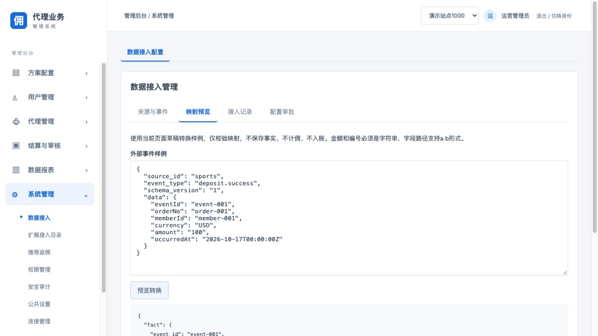

# 可配置数据接入

- [使用流程](#usage)
- [配置字段](#fields)
- [来源系统协议](#protocol)
- [部署与权限](#deployment)
- [边界与验收](#limits)

<a id="usage"></a>
## 使用流程



在19486后台打开“系统管理 → 数据接入”。“来源与事件”维护草稿，“映射预览”用样例检查转换结果；预览不会保存事实、计算佣金或入账。填写原因并提交后，由另一名有权限的运营人员审批，批准后才会发布新修订。配置审批使用独立权限 `ingestion:approve`，代理关系审批权限不能替代。

```text
Draft -> Preview -> Request -> Independent approval -> Published revision
                                                         |
Source event -> Service identity + HMAC -> Field mapping --+
                   |
                   v
            Member resolution -> Existing fact engine -> Receipt
                   |
                   v
           All source day watermarks -> Daily settlement -> Existing review
```

“配置审批”可按审批编号读取配置快照；审批决定仍在原审核页面进行。“接入记录”显示本站最近100条已提交的接收结果。校验失败不会生成业务事实，其失败结果按现有请求审计查询。记录不保存原始事件正文或签名密钥。

<a id="fields"></a>
## 配置字段

| 字段 | 含义与限制 |
| --- | --- |
| source_id | 本站来源编号，最多64字符；sandbox保留 |
| subject_id | 来源服务身份，必须与实际调用主体一致；运营身份不能投递业务事件 |
| member_source_id | 会员注册来源编号，用它解析外部会员；不会新建会员或绑定代理关系 |
| key_ref | 本站服务端密钥引用，浏览器只能选引用 |
| enabled | 是否允许新事实；停用仍可关闭历史业务日 |
| event_type / schema_version | 可自定义外部事件名与结构版本；同一组合只能配置一次 |
| target_kind | 引擎支持的充值成功、投注已结算、提现成功统计 |
| fields | 标准字段到data对象的路径，如 `order.id`；最多8段，不执行脚本或数组表达式 |
| amount_unit | MINOR表示最小单位整数；MAJOR表示主单位十进制字符串 |
| currency_scale | 必须与业务发生时的权威币种精度相符；不能通过映射改变币种精度 |

事件编号、业务单号、会员编号、金额必须为字符串，避免大整数和浮点精度丢失。主单位转换不四舍五入，超出精度的非零小数直接拒绝。不接受指数、负号或科学计数法。时间为带时区的RFC3339，最高微秒精度。IP、设备、共享账户可选字段只接收SHA256十六进制摘要，不接收原始个人信息。

已发布来源的服务主体、会员来源及既有事件版本不可覆盖或删除；调整映射应新增结构版本。需要停止来源时提交停用申请。每站最多64个来源，每来源最多32个事件版本。

<a id="protocol"></a>
## 来源系统协议

管理接口使用既有运营登录、站点会话、CSRF与权限控制。来源投递使用已有服务身份认证，不能复用运营浏览器凭据。

| 方法与路径 | 用途 |
| --- | --- |
| GET /v1/affiliate/ingestion/config | 读取已发布修订和配置 |
| GET /v1/affiliate/ingestion/key-refs | 读取本站密钥引用，不返回密钥 |
| POST /v1/affiliate/ingestion/config-requests | 提交expected_revision、config、reason，返回202和审批编号 |
| GET /v1/affiliate/ingestion/config-requests/{id} | 读取本站申请及结构化配置快照 |
| POST /v1/affiliate/ingestion/preview | 提交config与envelope，返回preview_only和标准事实 |
| GET /v1/affiliate/ingestion/records | 最近100条已接收事实记录 |

配置申请必须携带 `Idempotency-Key`。修订冲突时重新读取，不能静默覆盖。

事实仍投递到 `POST /v1/affiliate/business-facts`，配置来源正文示例：

```json
{
  "source_id": "sports",
  "event_type": "deposit.success",
  "schema_version": "1",
  "data": {
    "eventId": "event-001",
    "orderNo": "order-001",
    "memberId": "member-001",
    "currency": "USD",
    "amount": "1.23",
    "occurredAt": "2026-10-17T12:00:00Z"
  }
}
```

例如将 `event_id`映射到`eventId`、`business_id`映射到`orderNo`，金额使用MAJOR和2位精度，得到`amount_minor="123"`。会员必须已通过原注册流程进入系统。

签名请求头为 `X-Affiliate-Signature`，值为小写十六进制HMAC-SHA256。签名输入按UTF-8拼接，最后直接附加**实际发送的原始正文**：

```text
affiliate-ingestion-v1\n{tenant_id}\n{app_id}\n{source_id}\n{raw_body}
```

签名后不要重新排版正文。相同来源和事件编号只记一次；同一幂等键或事件编号对应不同原始正文返回409，即使变化的字段未参与映射也拒绝。签名或来源身份错误返回403；结构、单位或映射错误返回400。失败应修正原因后重试，不能换事件编号绕过防重。

来源日关闭仍使用 `POST /v1/affiliate/source-watermarks`，正文包含source_id、business_day、fact_count、facts_digest，沿用原清单摘要协议；签名前缀为 `affiliate-watermark-v1`，密钥为该来源当前引用。当天曾启用过的来源都须完成水位核对；中途停用不能跳过关账。水位不齐时worker等待，不冻结业务日。

<a id="deployment"></a>
## 部署与权限

API与worker均设置 `LOCAL_INGESTION_ENABLED=true`，同时保持 `LOCAL_AFFILIATE_FLOW_ENABLED=true`。模块默认关闭。启用时初始化本模块三张表，不变更原迁移摘要。数据库部署账号须具备建表权限，失败时模块拒绝启动/处理。

`AFFILIATE_INGESTION_KEYS_FILE`指向仅进程用户可读写的普通JSON文件（0600，最大64KiB）。结构为数组，元素包含key_ref、tenant_id、app_id、secret。secret不少于32字符；通过部署系统注入，不写入Git、浏览器、截图或日志。API与worker使用一致的文件。密钥按站点和应用查找，跨站引用无效。轮换密钥需要来源发送方同步切换；事务内按当前引用和文件重新验签。文件轮换需部署协调，不会撤销已通过事务复核的在途请求。

运营viewer：查看；applicant：查看、配置申请和预览；approver：查看、独立审批。没有任何运营角色因此获得业务事实投递权限。

<a id="limits"></a>
## 边界与验收

本次配置负责把外部字段转换为已有引擎事实，不能创建任意计算代码或新的佣金算法。会员注册、代理绑定继续使用原有签名注册链路。旧sandbox协议及其日水位要求保留；新增来源不会自动替代sandbox。接入正式来源前需明确旧来源的关账或迁移安排。

【涉及其他业务】复用原事实接收、会员映射、风控达标、日结、独立审批与角色映射。新增来源仅在开关开启且审批发布后生效。已验证真实MySQL的配置审批、自审拒绝、签名拒绝、跨站拒绝、重复正文冲突、金额精确转换、停用复核、旧sandbox兼容，以及缺少新增来源水位不冻结、补齐后可日结。全后端race测试通过；前端构建与现有测试通过。真实第三方服务尚未接入，不能据此声称外部生产链路已验收。
