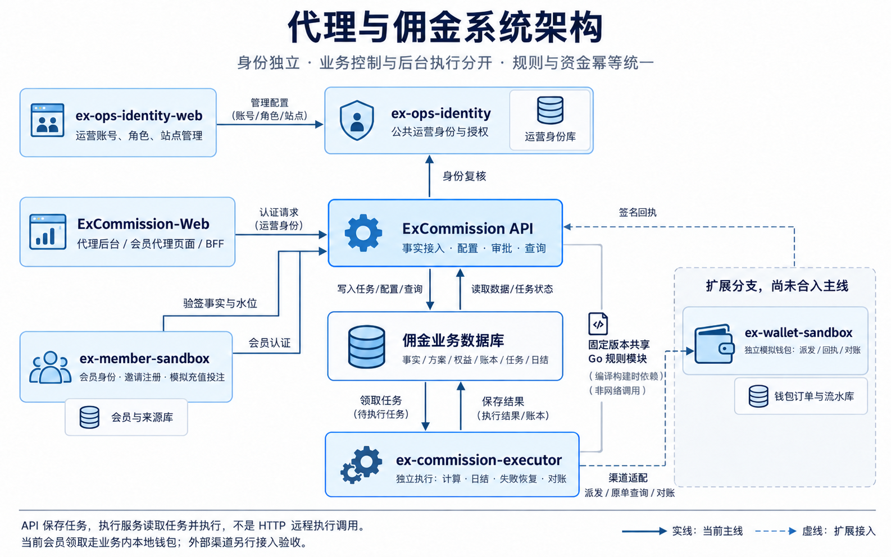
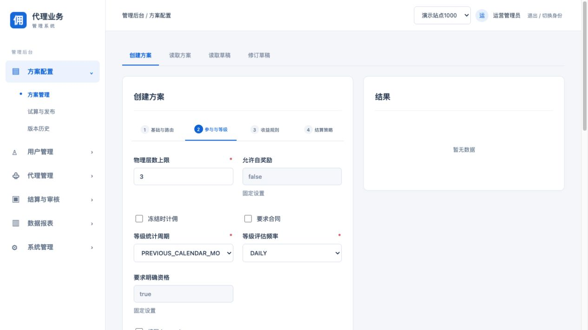

# ExCommission 工程说明

负责代理和佣金业务的 Go 后端。运营登录接入独立身份中心后，原业务模块、可配置条件、结算与审批仍归本工程。

## 目录

- [系统关系](#系统关系)
- [业务职责](#业务职责)
- [身份和权限](#身份和权限)
- [配置与运行](#配置与运行)
- [流程与异常处理](#流程与异常处理)
- [验证与限制](#验证与限制)

## 系统关系



系统统一入口见 [系统架构与调用关系](系统架构与调用关系.md)，包含七个工程的职责、身份边界、调用图、数据归属及当前接入状态。

ExCommission 是业务API与共享规则主工程；独立 `ex-commission-executor` 从同一业务库读取任务执行。运营身份和会员身份分别管理，代理后台与运营中心各自保留页面。独立钱包渠道的适配分支未自动计入本次主线。

本地 `ex-member-sandbox-identity` 对应 `ex-member-sandbox` 的身份组件/目录，不另算一个业务系统；`ex-commission-worker` 已统一命名为 `ex-commission-executor`。端口请看统一架构页和实际运行配置，避免把历史联调实例当作系统边界。

## 业务职责

| 模块 | 功能 | 主要代码 |
|---|---|---|
| 方案 | 路由、参与范围、等级条件、收益规则、结算策略、试算、发布及版本回退 | `internal/plans`、`internal/runtime/plans.go` |
| 代理 | 创建代理、邀请关系、资格等级、目录与下线查询 | `internal/agents`、`internal/runtime/directory.go` |
| 代理扩展 | 三层返佣、奖励阶梯、IP/设备/共享账户规则、站点配置、日结与奖励 | `internal/affiliateflow`、`internal/runtime/affiliate_flow.go` |
| 账务和结算 | 权益、账簿、结算单、付款、对账、退款与修正 | `internal/runtime/settlement.go`、`payments.go`、`refunds.go`、`recovery.go` |
| 审批和风控 | 独立审批、冻结解除、审计、失败恢复 | `internal/workflow`、`internal/runtime/risk_audit.go` |
| 报表 | 收益/财务/成本查询、快照导出与下载 | `internal/reporting`、`internal/runtime/reports.go` |



图为配套 ExCommission-Web 操作本工程规则的页面。后端本身不提供管理页面。

## 身份和权限

`internal/identity/adapters/ops.go` 使用固定的身份接口及本站映射。通用身份响应中的外部自报权限、租户和应用不会成为业务授权依据。

| 角色 | 本工程能力 | 保留边界 |
|---|---|---|
| viewer | 查看业务数据、方案、报表等 | 不写入、不付款、不审批 |
| applicant | 原申请人业务能力：条件编辑、试算发布申请、结算付款对账、导出、风控及修正申请 | 不能据此获得审批角色专属能力 |
| approver | 原独立审批能力、业务读取和审批恢复 | 不拥有方案编辑或付款写入权限 |

角色可组合，但同一主体仍不能审批自己的申请。全局运营管理员并不自动获得业务角色。原始认证作用域参与后续校验，复制 Principal 并改写站点不能扩大授权。

会员本人接口依赖会员身份；运营账号管理位于19586。签名事实、水位和渠道回调有独立接入约束。

## 配置与运行

Go 1.26.5；业务数据库为 MySQL。依赖及完整启动以根 README 和对应本地配置为准，不在文档中保存真实密码。

| 配置 | 用途 |
|---|---|
| `OPS_IDENTITY_CONFIG_FILE` | 权限0600的运营身份接入文件 |
| `endpoint` | 当前使用 `http://127.0.0.1:19587/internal/identity/introspect` |
| `secret` | 服务端接入密钥，不返回浏览器 |
| `sites` | 本系统固定的 site_id 到 tenant_id/app_id 映射 |

```sh
mkdir -p .local
go build -o .local/api ./cmd/api
go build -o .local/worker ./cmd/worker
```

先加载本机私有运行配置，再启动 API 和 worker。不要把此联调私有配置复制到 Git。身份配置缺省时保留旧本地身份兼容，但当前运营入口使用个人运营账号。

## 流程与异常处理

```text
Edit draft -> Simulate -> Submit request -> Independent review -> Scheduled activation
Signed facts -> Deduplicate -> Calculate -> Settle -> Review -> Claim -> Wallet receipt
```

更新必须携带对应版本/修订及幂等键。本人审批拒绝，旧版本冲突须重新读取；结果未知先查询原请求，不创建第二笔付款。奖励状态和钱包回执分开判断，领取接口成功与实际到账以原回执及查询结果核验。

## 验证与限制

2026-10-17：真实MySQL全量 `go test -race -count=1 ./...` 通过；身份scope、角色隔离、撤权、双站点审计有专项测试。已用运营账号读取三种报表及配置，会员重复领取409且钱包不变。

【涉及其他业务】运营身份接入影响方案、结算、付款、报表、风控和审批调用链；原资金事务及幂等保留。未执行真实付款，未逐个页面完成浏览器验收，不能将本地测试结果作为生产验收。
