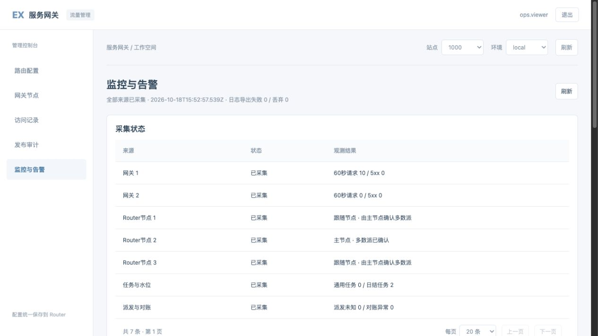

# 监控、告警与日志接入

目录：[目标与入口](#entry) · [采集与判断](#signals) · [告警状态](#alerts) · [编号追踪](#trace) · [日志适配](#logs) · [部署配置](#config) · [验收与边界](#acceptance)

<a id="entry"></a>
## 目标与入口

在网关管理 Web 的“监控与告警”统一查看网关错误、Router多数派、任务积压、水位缺失、派发未知和对账差异。本地入口为 `http://127.0.0.1:19782/`，使用原运营账号及站点授权。首次默认20条，可选20/50/100。

监控为独立只读模块，不触发结算、审核、派发、重试或调账。资金异常先查询原单，不能根据告警重复派发。



```text
Fixed read-only ops account --> Ops bootstrap identity
             |
             v
Console background collector (15 seconds)
  |              |                   |
Gateway status   Router quorum       Commission summaries
  +--------------+-------------------+
                 |
                 v
        Rules -> Alert journal -> Console
                 |
                 v
        LogSink -> JSONL / future third-party adapter

Request ID -> Gateway records -> Related business ID -> Scoped audit
                          +----> optional TraceSearch adapter
```

<a id="signals"></a>
## 采集与判断

| 信号 | 来源 | 默认判断及下一步 |
| --- | --- | --- |
| 网关错误 | 最近60秒独立计数 | 至少20请求且5xx占比达到5%时告警；查看节点及编号，不从最近2000条记录推算错误率 |
| Router多数派 | 各节点观测及Leader VerifyLeader | 必须取得唯一Leader的实际多数派确认，且可达节点不少于固定节点多数；存活或知道Leader地址不表示可提交 |
| 任务积压 | 通用任务、代理日结 | QUEUED/READY/RETRY_WAIT/DEAD/SUSPENDED/FAILED/RUNNING等待超过300秒时提示；不自动恢复任务 |
| 水位缺失 | 日结WAITING_WATERMARK | 按waiting_since等待超过600秒，显示任务、方案、日期及缺失来源；明细最多100条，汇总不受该限制 |
| 派发未知 | payment_orders状态UNKNOWN | 严重告警，只查询原业务单，禁止重发作为处理手段 |
| 对账差异 | 已持久化的非PENDING/MATCHED对账状态 | 严重告警，查看原付款和回执；该统计不代替执行对账，不推测未记录的外部差异 |
| 来源不可用 | 任一采集失败、无权限或格式错误 | 明确未知/不可达，不返回健康或伪造零值 |

监控账号登录、会话检查直接访问固定运营引导地址，避免Router失去多数派时同时失去监控身份校验。沿用原运营认证、撤权和账号状态，不创建新的共享身份。错误凭据采用30秒至5分钟有界退避，不持续撞击登录限流。

<a id="alerts"></a>
## 告警状态

同一站点、环境、规则、资源保持一条活动告警。首次异常记录TRIGGERED，重复异常累计次数；只有连续两次健康样本才记录RECOVERED。恢复后再次异常创建新的触发事件。采集未知保留原异常，不将未知当作恢复。

告警状态及最近10000条事件以0600文件原子替换保存，重启继续使用。未知采样或认证失败会中断连续健康计数，旧业务状态明确标为未知。排他锁拒绝两个控制台进程共写一个文件；陈旧锁不自动清理；部署方须停止并确认所有旧实例退出后，在无并发启动时人工清理锁，再启动唯一实例。它是当前单控制台存储，不能用于多主机共享；控制台多副本部署需要后续接入共享告警存储或唯一采集器。

<a id="trace"></a>
## 请求编号追踪

| 场景 | 行为 |
| --- | --- |
| 网关编号 | 查询各节点最近2000条记录，返回上游编号和业务编号 |
| 业务编号 | 按本站租户/应用查询数据库审计 |
| 已有关联 | 最多跟随4个编号、32次只读源查询、8路并发，进程最多4个并行追踪查询 |
| 外部日志 | 通过TraceSearch适配器查询；必须严格过滤本站、环境和编号 |
| 无记录 | 可能尚未记录、已过期、节点重启或源不可用，不等于请求没有发生 |

网关保留原始响应字节，从上游响应头及最多64KiB的JSON响应提取合法request_id；不保存正文，非JSON、大响应及旧历史不猜测关联。原始读取失败也保持失败语义。原生请求编号不等同于W3C trace_id，接OTLP时需要显式映射，不能伪造已存在的分布式Span。

<a id="logs"></a>
## 日志适配接口

协议位置：`ex-service-gateway-web/server/monitoring/ports.d.ts`；运行实现为logging.mjs和trace.mjs。

| 接口 | 用途 | 安全及失败约束 |
| --- | --- | --- |
| LogSink.emit(record, options) | 导出结构化监控日志 | 只允许协议白名单，禁止正文、Cookie、令牌、密码和原始错误对象 |
| TraceSearch.search(query, options) | 按编号查第三方日志 | 只接收site/environment/request_id/page/page_size，不接收浏览器DSL、索引名或上游地址 |
| BufferedSink.health() | 查看排队、丢弃及失败 | 默认队列1000条，外部失败不阻塞资金事务，不无限重试 |

通过 `createMonitoring(cfg, ops, {logSink, traceSearch})` 注入适配器，业务采集和告警规则不绑定ES客户端。默认JSONL每份约10MiB，保留当前及一份轮转文件；文件0600。输出包含schema_version、UTC时间、服务、站点、环境、请求编号、可选trace/span及业务单号、状态、耗时、错误码与事件ID。

后续接ES/OpenSearch可增加批量适配器：固定服务端集群及索引白名单、独立最小权限凭据、TLS校验、有界批次和重试，以稳定event_id进行幂等写入。查询适配器必须把站点和环境作为不可覆盖过滤条件；外部返回其他范围的数据会整源拒绝，允许字段以外的内容不会返回浏览器。也可接OTLP或其他平台，但本期没有连接任何外部日志服务。

当前协议用于新增监控日志；各系统原stdout/stderr可由独立采集Agent接入，不表示全部历史日志已转换。原数据库资金审计仍为依据，本地监控日志不能替代资金审计或作为资金重试依据。

<a id="config"></a>
## 部署配置

网关Web原私有配置增加monitoring字段，示例见本工程 `configs/monitoring.example.json`。credentials_file、state_file、log_file必须是互不相同的绝对路径。账号文件只包含username和password，权限0600；账号在所配置站点只能具有viewer授权，否则采集拒绝。监控不会自动关闭OTP或绕过二次验证，开启OTP后应另行设计受信机器认证。

scopes固定配置站点、环境和佣金API地址，浏览器不能添加上游。interval_ms默认15000，允许10000至300000。阈值在部署配置中设置；当前页面没有规则发布写入口，也没有外部通知发送。

网关原Web固定静态资源路径需要包含 `/monitoring.js`，包括HTTPS入口。业务接口分别为 `/admin/monitoring`、`/admin/trace`；Router为 `/v1/monitoring/cluster`；佣金为 `/v1/monitoring/tasks`、`/v1/monitoring/payments`、`/v1/monitoring/trace`。业务按tasks:read、payments:read、audit:read独立授权。安装035索引迁移以支持按本站状态及编号检索。

Web采集后台在进程存活时持续执行，与浏览器是否打开无关。监控控制台自身单点、引导身份服务及日志卷仍需部署监控；本期不能发现自身整台主机停机，应由外部平台健康检查补齐。

<a id="acceptance"></a>
## 验收与边界

2026-10-18本地验证：两个网关、三个Router节点、任务及付款共七个观测源真实采集；分页、越站拒绝、参数上限通过。停止两个Router跟随节点后取得多数派严重告警，恢复后连续两次正常产生恢复记录；所有节点已恢复。网关返回编号可自动查到关联业务编号及原业务审计，无资金变更。

单元测试覆盖告警去重、健康与未知交替不误恢复、双进程同时遇陈旧锁均拒绝启动、认证失败标记旧状态未知、重启持久化、日志脱敏、适配器有界队列、跨站外部数据拒绝、账号退避、独立权限、计数窗口与响应原字节保持。原六入口、登录退出、来源校验、会员领取参数校验及钱包机器只读查询回归通过。

【涉及其他业务】变更覆盖网关访问记录与响应编号观测、Router多数派只读检查、佣金任务/付款/审计只读查询、Web运营会话调用链；不改业务权限、签名、资金状态或重试策略。本地集成构建使用只读Go overlay保留原运行分支已有自注册/发现装配，未搬移或提交其他工作区改动。真实ES/第三方日志平台、多主机监控HA、外部通知尚未联调。

提交前补充验收：真实MySQL事务内插入独立测试作用域的五种日结状态，连续刷新updated_at三次，积压起点仍保持业务到期/开始/完成/水位等待时间，跨站返回为空；索引已核验存在，测试事务全部回滚。BLOCKED仅展示，不自动触发停止方案的积压重试。

后续非阻断项：JSON编号关联同步预读可能推迟首包；监控窗口重启清零但目前未返回进程启动时间。按用户要求记录后续完善，不继续扩大本次提交。
