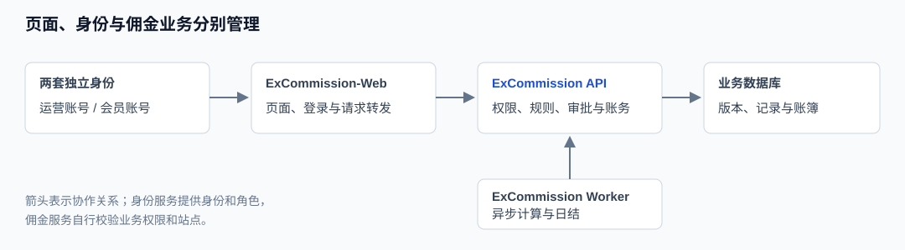
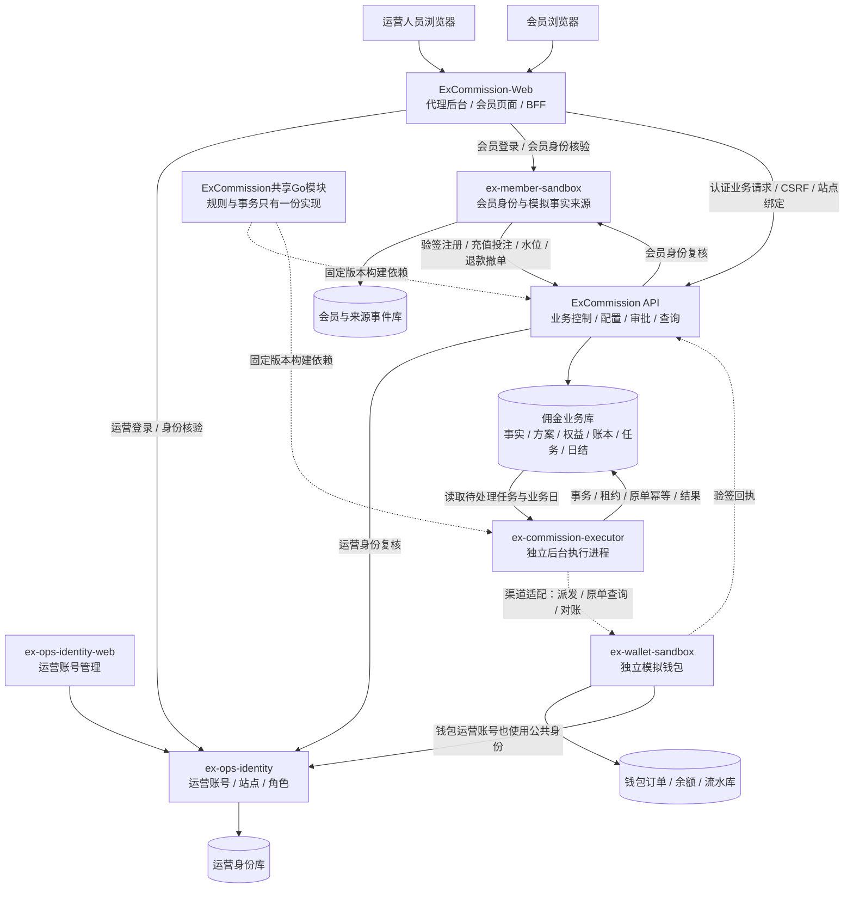
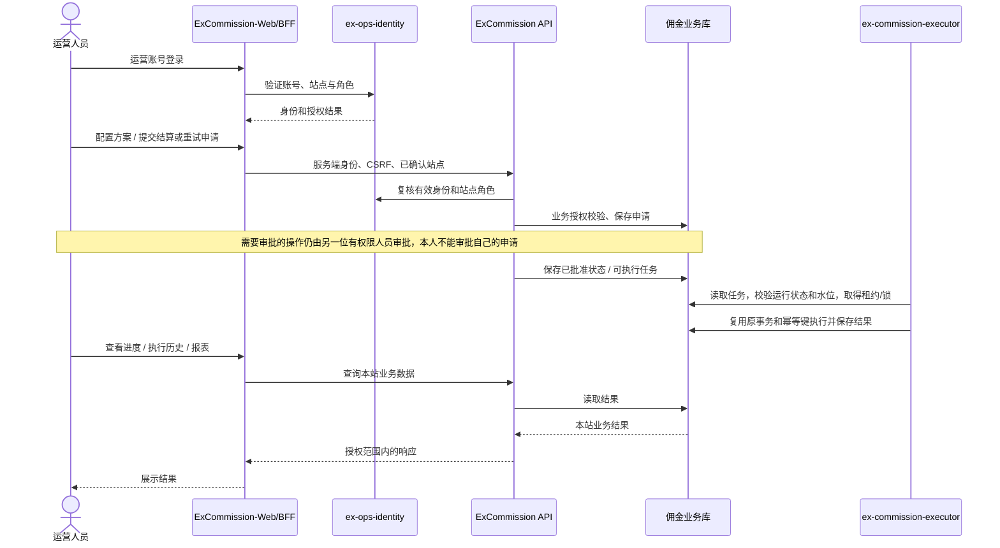
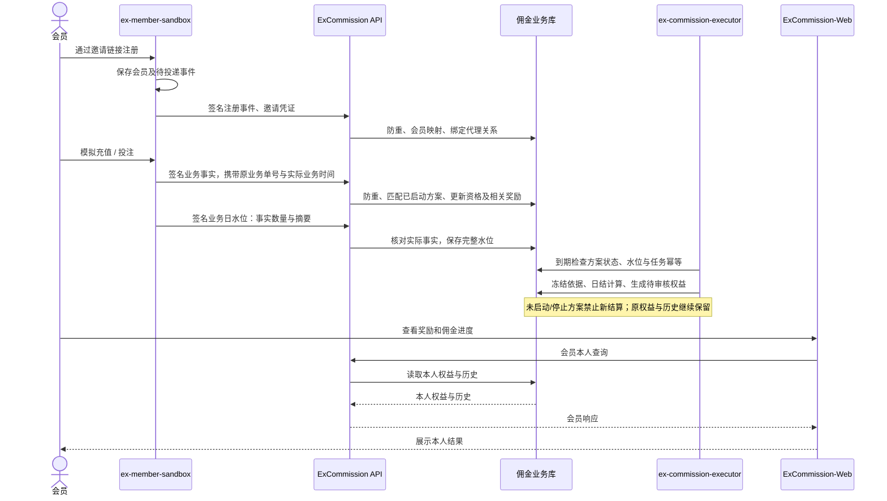
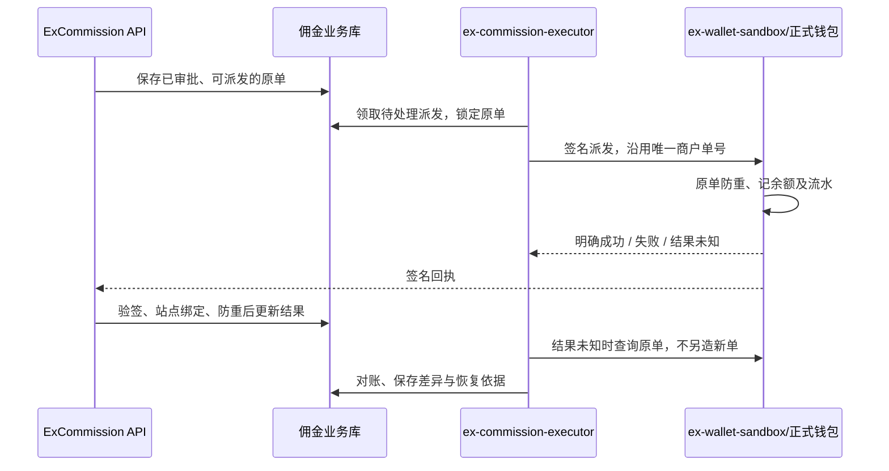

# 系统架构与调用关系

本页是这组代理与佣金工程的统一架构说明，以 ExCommission 为业务主工程。各系统独立运行；运营账号、会员账号、佣金账务和钱包数据分别归属各自系统。

## 1. 每个工程主要做什么

| 工程 | 负责什么 | 不承担什么 |
| --- | --- | --- |
| **ExCommission** | 代理关系、规则配置、来源事实、审批、佣金权益与账本、任务、查询和报表 | 不管理运营或会员密码，不提供管理页面 |
| **ExCommission-Web** | 代理后台、会员代理页面、服务端BFF会话与受控转发 | 浏览器不直接访问数据库、不持有服务密钥、不决定资金结果 |
| **ex-commission-executor** | 独立运行计佣、日结、派发/退款恢复、对账等原后台作业 | 不注册业务管理API，不另写一套计算或账务规则 |
| **ex-ops-identity** | 公共运营账号、认证、站点和角色授权、二次验证与身份审计 | 不替业务系统决定具体资金权限或审批结果 |
| **ex-ops-identity-web** | 运营账号、角色和站点管理界面 | 不融合代理业务页面 |
| **ex-member-sandbox** | 模拟会员注册登录、邀请、充值/投注及退款撤单事实与可靠投递 | 不作为正式会员平台或真实支付来源 |
| **ex-wallet-sandbox** | 独立模拟钱包的派发、原单查询、回执、余额流水与对账 | 不执行真实付款、提现或代理计佣 |

`ex-member-sandbox-identity` 是模拟会员工程的本地目录/身份组件名称，不是新增的第八个业务系统。`ex-commission-worker` 是拆分过程的旧命名，现统一称 `ex-commission-executor`；本轮没有再增加第三个独立“调度系统”。

## 2. 系统架构图

GitHub可直接渲染下面的图。实线表示本次主线的调用或数据协作，虚线表示独立模拟钱包渠道接入的扩展关系。

**当前主线不是 API 通过HTTP调用 executor。** API保存任务和已审批的业务状态，executor从同一业务库领取/扫描待处理工作并提交结果，API再查询展示。两者是独立进程，复用同一套规则模块。执行端只开放健康探针，不开放远程执行或业务管理接口。

## 3. 运营人员操作调用图

运营中心提供身份与角色，ExCommission负责把角色映射成业务权限。业务系统不能把浏览器自报的站点或权限直接当成授权。执行进程沿用 `system-worker` 审计身份，不需要新建运营登录页面，也不绕过审批。

## 4. 会员事实到日结的调用图

事实接入、资格刷新等部分处理仍可能在 API 业务事务中完成；拆分不是把所有业务函数都远程化。异步计佣、日结及恢复由独立执行进程承载。方案、生效时间、币种、账务与冲正仍执行各自已实现的规则。

## 5. 领取、派发与钱包边界

当前已验证的会员领取链路是在 ExCommission 自身业务事务中更新权益、账本及本地钱包记录。独立 `ex-wallet-sandbox` 已有自己的模拟系统与适配分支，但它的渠道适配尚未并入本次共享基线；不能把所有会员领取都描述为已经调用了外部钱包。

外部钱包渠道接入后的目标调用如下：

该图表示渠道协议分工，具体业务调用可能在API首次派发时立即发生，executor负责后台恢复与对账；不会为了图示而重写现有付款状态规则。充值退款、投注撤单由来源发送关联原事件的冲正事实；未领权益调整，已领权益保留追偿，不自动扣外部钱包。

## 6. 数据与部署边界

| 数据 | 归属 |
| --- | --- |
| 运营密码、角色、站点授权、身份会话 | ex-ops-identity自己的数据库 |
| 会员密码、会员登录、模拟来源事件及投递记录 | ex-member-sandbox自己的数据库 |
| 代理关系、方案、业务事实、权益账本、审批、任务、日结、追偿 | ExCommission业务数据库，API与executor共享 |
| 独立钱包的订单、余额、流水、回执队列 | ex-wallet-sandbox自己的数据库 |
| 浏览器会话与上游凭据 | 各Web/BFF的服务端边界；不暴露服务密钥给浏览器 |

独立executor不表示拆出第二份佣金数据库，也不表示新增另一套计佣算法。API、executor需要使用兼容的共享模块版本和相同的作用域/渠道配置；多站部署仍按既有单作用域worker配置安排实例。

## 7. 本地查看入口与当前状态

| 服务 | 入口 | 说明 |
| --- | --- | --- |
| 代理主后台 | http://localhost:19486/ | 原有业务后台实例 |
| 公共运营管理 | http://127.0.0.1:19586/ | 账号、角色、站点管理 |
| 公共运营身份API | http://127.0.0.1:19587/ | 服务端身份服务 |
| 独立执行演示后台 | http://127.0.0.1:19799/ | 本次拆分的隔离租户，任务页可看完成和停止记录 |
| 隔离ExCommission API | http://127.0.0.1:19895/readyz | 演示API进程 |
| 独立执行服务 | http://127.0.0.1:19896/readyz | 无业务页面；只看健康状态 |
| 独立模拟钱包后台 | http://127.0.0.1:19986/ | 独立钱包工程的约定演示入口，需按其工程单独启动 |

端口属于各本地实例，不是跨环境的固定服务地址；上述入口不代表所有实例当前都在线。会员模拟端口以所用会员工程的本地配置为准，不能把历史验收端口混成另一套架构。

已验证：签名模拟注册/邀请/充值投注、水位、原领取、冲正、方案启停、API与执行进程分离、新旧进程并行防重、重启恢复及独立容器。真实外部会员、充值投注来源、正式钱包与生产负载仍需后续接入验收。

【涉及其他业务】本次执行入口拆分承载计佣、日结、派发/退款恢复及对账，原权限、审批与资金规则未改。钱包虚线链路属于另一个适配分支，架构文档不会将其自动视为已合入或已对真实资金验证。
